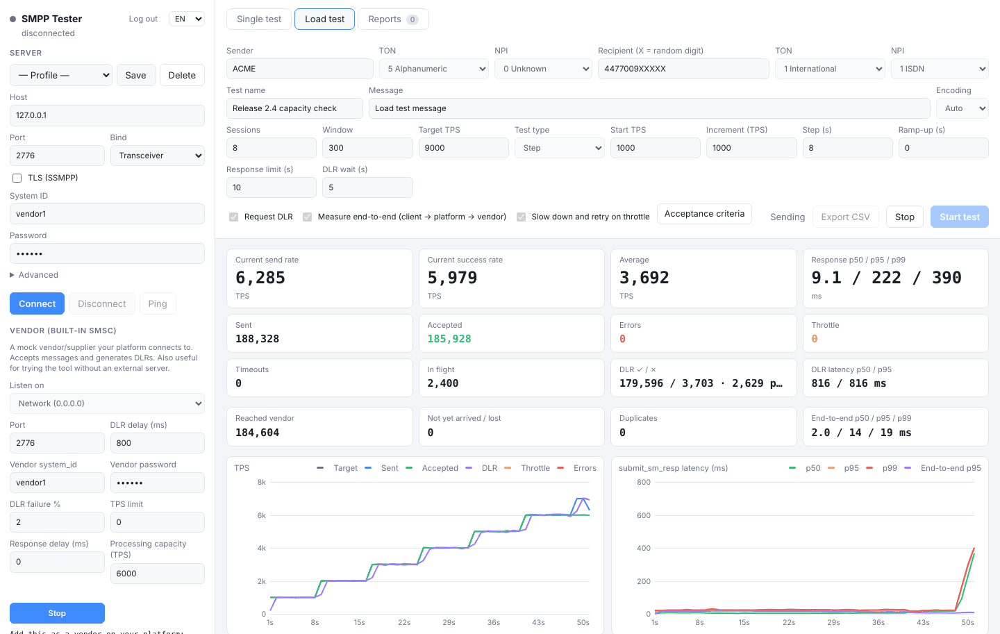
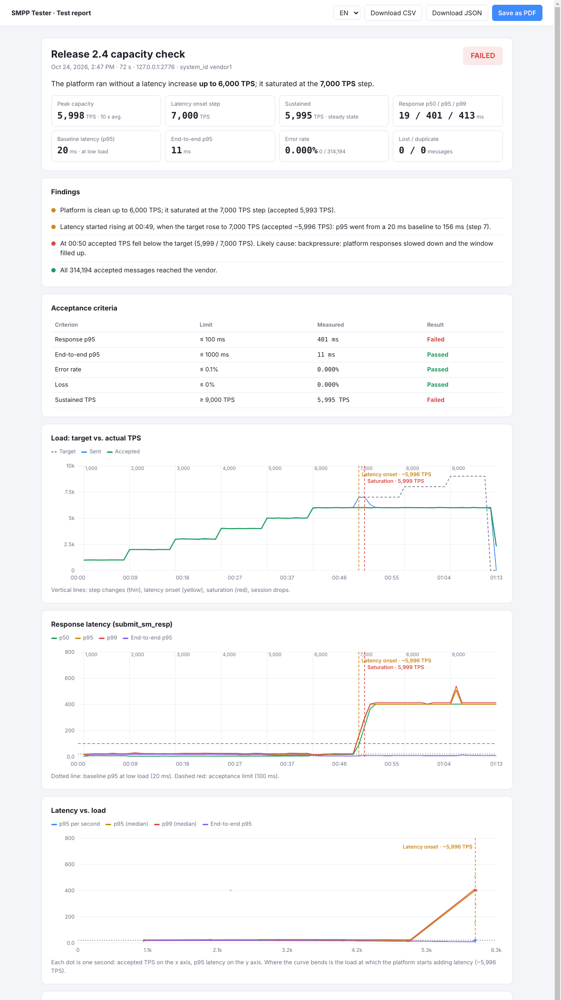
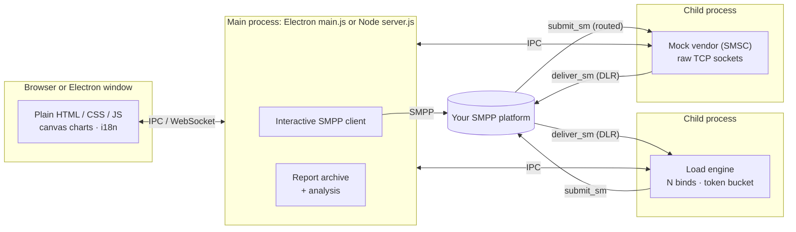

<div align="center">


# SMPP Tester

**Find out where your SMS platform starts to slow down — before your customers do.**

An SMPP test client, a 10,000 TPS load generator and a mock SMSC in one tool.<br>
It plays **both ends** of your platform at once and writes the performance report for you.

[](https://github.com/peritotr/smpp-tester/actions/workflows/ci.yml)
[](https://github.com/peritotr/smpp-tester/releases)
[](LICENSE)


[Türkçe](README.tr.md) · [Server setup guide](docs/server-setup.md) · [Changelog](CHANGELOG.md)

</div>



## Why

Every SMS platform eventually meets the same questions — usually in production, at the worst possible moment:

- How many TPS does it **really** sustain, and at what load does latency start to climb?
- Does every accepted message reach the downstream vendor — **exactly once**?
- How long do DLRs take to come back, and what happens to that under load?
- What does the platform do when a vendor throttles, slows down or drops the connection?

Generic load tools only see one side of the platform: they can tell you how fast it *accepts* messages, not what happens to them afterwards. SMPP Tester sits on **both sides**. It is the customer (ESME) pushing traffic in and the vendor (SMSC) receiving the routed traffic and sending DLRs back. Every message carries an invisible marker, so the tool can follow it through your platform and measure what no single-sided tool can: **end-to-end latency, loss and duplicate delivery**.

```
SMPP Tester (client) ──submit_sm──▶  YOUR PLATFORM  ──submit_sm──▶  SMPP Tester (vendor)
          ◀────────── DLR ─────────                ◀──── DLR ─────
```

When the run ends, you don't get a wall of numbers. You get a report that says, in plain language, *"the platform is clean up to 6,000 TPS; latency rose at the 7,000 TPS step; likely cause: backpressure — responses slowed down and the window filled up"*, with the charts to back it up.

### Highlights

- **10,000 TPS with DLRs** from a 2-vCPU machine, with client and mock vendor on the same box
- **Step tests** that find the knee point automatically
- **End-to-end tracking** through your platform: loss, duplicates, latency
- **A mock vendor you can misbehave on purpose**: throttling, slow responses, failing DLRs, a queue that backs up
- **Pass / fail against your SLA**, saved reports, PDF export
- **Desktop or server**: the same UI as a native app or behind a password in your browser
- **No framework, no database, no build step for the UI**: about 3,500 lines you can read in an afternoon

## Features

**Single test**
- Full connection settings: host, port, TLS, system_id, password, system_type, bind type (TRX/TX/RX), interface version, TON/NPI, address range, enquire_link interval; saved profiles with encrypted passwords
- `submit_sm` with GSM-7, Latin-1 or UCS-2 (auto-detected), concatenated messages via UDH or `message_payload`, live character/part counter
- Sent messages table with `submit_sm_resp` status, message_id, response time, DLR status and DLR latency; DLR and MO inbox; full PDU log with export

**Load test**
- Parallel binds (sessions), per-session window, target TPS with ramp-up, by duration or message count
- **Step test**: climbs from a start TPS to a target in steps to find the knee point
- Automatic slow-down and retry on `ESME_RTHROTTLED` / `ESME_RMSGQFUL`
- Random recipients (`4477009XXXXX`), live TPS and latency charts (p50/p95/p99), error code and DLR status breakdown
- Sustains 10,000 TPS with DLRs on a 2-vCPU machine (client and mock vendor on the same box)

**Built-in vendor (mock SMSC)**
- Your platform binds to it as a supplier; it accepts messages and returns DLRs
- Configurable DLR delay and failure rate, TPS limit (returns throttling errors), response delay, processing capacity (simulates a slow operator with a growing queue), MO messages
- **End-to-end tracking**: messages carry a marker; the vendor reports how many arrived, how many were lost or duplicated, and the end-to-end latency through your platform
- **Vendor messages**: the last 1,000 messages that reached the vendor, decoded: account, sender, recipient, `data_coding` with the alphabet it means (GSM7, UCS2, Latin-1 …), concatenated part (UDH) and text, with the raw bytes in hex. Search by number or text, export to CSV. Answers "did my message arrive, with which text and in which encoding?"

**Performance reports**
- Saved automatically after every load test; printable to PDF, exportable to CSV/JSON
- Finds the **latency onset** (when and at what TPS p95 left its baseline), the **saturation point** and its likely cause (throttling, backpressure, session loss, errors), peak capacity, latency drift under steady load
- Acceptance criteria (p95/p99, end-to-end p95, error rate, loss, minimum TPS) → **PASSED / FAILED**
- Step table, latency-vs-load curve, annotated timelines, event log



**Interface in English and Turkish** (switch in the top-left corner).

## Getting started

### Desktop app

Download the latest build for your OS from [Releases](https://github.com/peritotr/smpp-tester/releases):

| OS | File |
| --- | --- |
| macOS (Apple Silicon / Intel) | `SMPP-Tester-x.y.z-mac-arm64.dmg` / `-mac-x64.dmg` |
| Windows | `SMPP-Tester-x.y.z-win-x64-setup.exe` (installer) or `-win-x64-portable.exe` |
| Linux | `SMPP-Tester-x.y.z-linux-x86_64.AppImage` or `-linux-x64.tar.gz` |

The builds are not code-signed. On macOS, the first time you open the app, go to **System Settings → Privacy & Security → Open Anyway** (or run `xattr -dr com.apple.quarantine "/Applications/SMPP Tester.app"`). On Windows, click **More info → Run anyway** in SmartScreen.

To run from source instead:

```bash
git clone https://github.com/peritotr/smpp-tester.git
cd smpp-tester
npm install
npm start
```

### Server (Docker)

For load tests, run it on a Linux server in the same data centre as your platform — but not on the same machine.

```bash
mkdir smpp-tester && cd smpp-tester
curl -fsSLO https://raw.githubusercontent.com/peritotr/smpp-tester/main/docker-compose.yml
curl -fsSL https://raw.githubusercontent.com/peritotr/smpp-tester/main/.env.example -o .env
nano .env                    # set UI_PASSWORD
docker compose up -d
```

Then open the UI through an SSH tunnel from your computer:

```bash
ssh -L 8080:127.0.0.1:8080 user@your-server
# browse to http://localhost:8080
```

The full walkthrough — server sizing, firewall, reverse proxy with HTTPS, platform configuration and a test plan — is in **[docs/server-setup.md](docs/server-setup.md)**.

Without Docker: `npm install --omit=dev && UI_PASSWORD=... node server.js`.

| Variable | Default | |
| --- | --- | --- |
| `UI_PASSWORD` | — | Required, at least 8 characters |
| `PORT` | `8080` | Web UI port |
| `HOST` | `0.0.0.0` (`127.0.0.1` in `.env.example`) | Address the web UI listens on |
| `DATA_DIR` | `./data` (`/data` in Docker) | Profiles, reports, vendor settings, secret key |
| `PUBLIC_IP` | — | IP shown as the vendor address in the UI |

## Testing your platform: a quick recipe

1. **Start the vendor** (bottom left): listen on *Network (0.0.0.0)*, port e.g. `2776`, a system_id and password.
2. **On your platform**, add a vendor/supplier connection to that IP:port as a **transceiver**, and route a test number range (e.g. `4477009…`) only to it.
3. **Create a test customer** on your platform with a TPS limit above your target.
4. **Connect the client** (top left) to your platform with that customer and send a single message to check the path end to end.
5. **Load test → Step**: start 500, increment 500, target 10,000, step 60 s, *Measure end-to-end* on. When it finishes, open the report.

### Choosing sessions and window

A session can carry roughly `window ÷ response time` messages per second. Size the window per session to at least
`2 × target TPS × response time (s) ÷ sessions` — for 10,000 TPS at 50 ms with 8 sessions that is about 125. If the *In flight* counter sits at `sessions × window`, the window is full: that means the platform is responding slowly, and a bigger window only makes the queue longer.

## How the analysis works

- **Baseline** — median p95 of the first, lightly loaded seconds (the first step in a step test).
- **Latency onset** — p95 above `max(2 × baseline, baseline + 20 ms)` (or the acceptance limit, if lower) for 3 consecutive seconds.
- **Saturation** — accepted TPS below 90% of a flat target for 3 consecutive seconds. The cause is inferred from that window: throttle responses → throttling; fewer bound sessions → session loss; window full > 30% of the time → backpressure; error responses → errors; otherwise the test machine could not keep up.
- **Step status** — a step is *saturated* when its median accepted TPS is below 95% of the step target, and *latency up* when its p95 is above the onset threshold.
- **Peak capacity** — best 10-second average of accepted TPS.

## Under the hood



**One codebase, two shells.** The SMPP client, load engine, mock vendor and analysis are plain Node.js modules. The desktop app wraps them in Electron (`main.js` + `preload.js`). The server edition wraps the same modules in a small HTTP + WebSocket server (`server.js`). The UI does not know which one it is talking to: `window.api` is supplied either by Electron's preload or by `ui/web-api.js` over a WebSocket.

**Measurement stays honest.** The load engine and the mock vendor each run in their own process (Electron `utilityProcess` on desktop, `child_process.fork` on the server). Each gets its own CPU core, and the UI can never slow the measurement down.

**How it reaches 10k TPS in JavaScript:**
- Each test message is encoded **once** into a PDU template. Per message, the engine only patches the bytes that change: sequence number, random recipient digits, end-to-end marker. That avoids building objects for every message.
- A **token bucket** ticks every 2 ms. Writes are batched per socket and flushed with a single `socket.write`.
- The **window** is enforced per session, so the engine never floods a platform that has stopped answering. Throttle responses shrink the rate multiplicatively, and it recovers over 3 s.
- The mock vendor skips the general-purpose PDU parser. It reads only the fields it needs straight from the TCP stream and coalesces responses per tick.
- Latency is recorded into **logarithmic histograms** (~3% buckets), so p50/p95/p99 cost O(1) memory however long the test runs.

**Analysis you can trust.** `ui/analysis.js` is a pure function from per-second rows to findings. The same code renders the report in the browser and summarises it for the archive in Node. It is covered by tests that run a real step test against a capacity-limited vendor and assert that the knee is found at the right step.

### Tech stack

| Layer | Built with |
| --- | --- |
| SMPP protocol | [node-smpp](https://github.com/farhadi/node-smpp) for the interactive client and PDU encoding; hand-written byte-level fast paths in the load engine and mock vendor |
| Runtime | Node.js 18+ (22 in Docker), worker processes over IPC |
| Desktop | Electron 33, `electron-builder` for DMG / NSIS / portable / AppImage builds, passwords in the OS keychain (`safeStorage`) |
| Server | Node `http` + [`ws`](https://github.com/websockets/ws), signed session cookies, AES-256-GCM for stored secrets, login rate limiting |
| UI | Vanilla HTML/CSS/JS, hand-drawn `<canvas>` charts, light/dark theme, a small i18n layer (English, Turkish) |
| Packaging | Docker (`node:22-alpine`, multi-arch amd64/arm64), Docker Compose with host networking |
| Quality | `node:test` suite (client, load engine, analysis, translations), GitHub Actions for CI and releases |

**Dependencies at runtime: two** (`smpp`, `ws`).

## Project layout


| Path | |
| --- | --- |
| `smpp-core.js` | Interactive SMPP client and encoding helpers |
| `load-engine.js`, `load-worker.js` | Load engine (own process): sessions, windowing, token-bucket rate control, histograms |
| `mock-smsc.js`, `mock-worker.js` | Mock vendor on raw sockets (own process) |
| `sms-decode.js` | Decodes incoming messages for the vendor messages list (data_coding, GSM 03.38, UCS2, UDH) |
| `reports.js`, `ui/analysis.js` | Report archive and performance analysis |
| `main.js`, `preload.js` | Desktop app (Electron) |
| `server.js`, `ui/web-api.js` | Web server edition (HTTP + WebSocket, password login) |
| `ui/` | User interface (plain HTML/CSS/JS, no framework), `ui/i18n.js` for translations |
| `test/` | Test suite (`npm test`) |
| `tools/` | `bench.js` (CLI benchmark), `report-demo.js`, `i18n-keys.js` |

## Development

```bash
npm install
npm start          # desktop app
npm run server     # web edition (set UI_PASSWORD first)
npm test           # client, load engine, analysis and translation tests
npm run bench      # 10,000 TPS for 30 s against the built-in vendor
npm run dist       # build installers for the current OS into dist/
```

Pushing a tag like `v1.4.0` builds the desktop apps for all three platforms, creates a GitHub Release, and publishes the Docker image to `ghcr.io/peritotr/smpp-tester`.

**Adding a language:** add a dictionary next to `TR` in `ui/i18n.js`, register it in `DICTS` and `LOCALES`, and add an `<option>` to the language selectors. `npm run i18n` lists strings that are still missing.

Issues and pull requests are welcome.

## Security

The web edition can push tens of thousands of messages per second into the platform it points at. Keep the UI behind an SSH tunnel or an HTTPS reverse proxy, use a strong `UI_PASSWORD`, and open the vendor port only to your platform's IP. Saved passwords are encrypted at rest (OS keychain on desktop, AES-256-GCM on the server).

Only test platforms you own or are authorised to test.

## License

[MIT](LICENSE) © Levent Karamanlı

Built on [node-smpp](https://github.com/farhadi/node-smpp).
