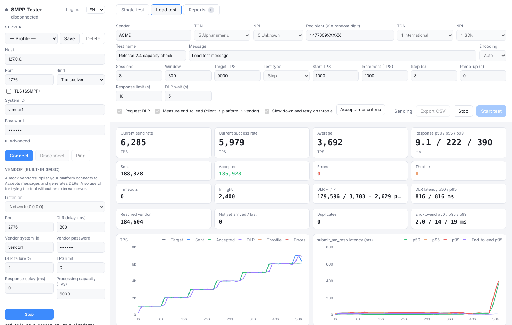
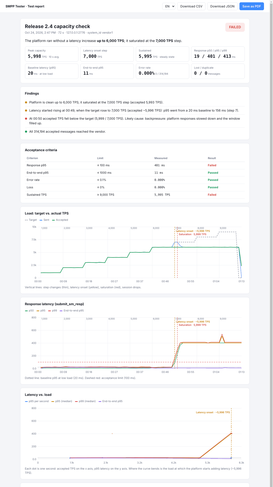
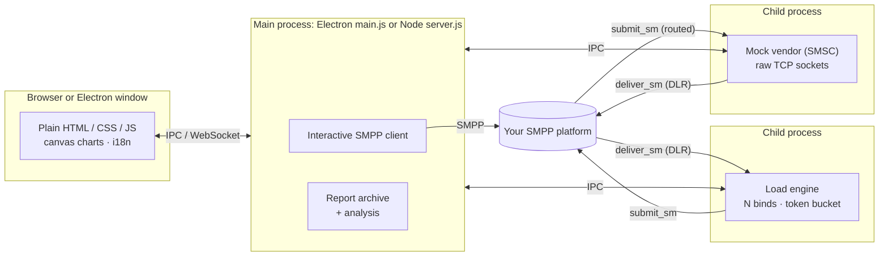

<div align="center">


# SMPP Tester

**Find out where your SMS platform starts to slow down — before your customers do.**

An SMPP test client, a 20,000 TPS load generator and a mock SMSC in one tool.<br>
It plays **both ends** of your platform at once and writes the performance report for you.

[](https://github.com/peritotr/smpp-tester/actions/workflows/ci.yml)
[](https://github.com/peritotr/smpp-tester/releases)
[](LICENSE)


[Türkçe](README.tr.md) · [Server setup guide](docs/server-setup.md) · [Changelog](CHANGELOG.md)

</div>



## Why

Every SMS platform eventually meets the same questions — usually in production, at the worst possible moment:

- How many TPS does it **really** sustain, and at what load does latency start to climb?
- Does every accepted message reach the downstream vendor — **exactly once**?
- How long do DLRs take to come back, and what happens to that under load?
- What does the platform do when a vendor throttles, slows down or drops the connection?

Generic load tools only see one side of the platform: they can tell you how fast it *accepts* messages, not what happens to them afterwards. SMPP Tester sits on **both sides**. It is the customer (ESME) pushing traffic in and the vendor (SMSC) receiving the routed traffic and sending DLRs back. Every message carries an invisible marker, so the tool can follow it through your platform and measure what no single-sided tool can: **end-to-end latency, loss and duplicate delivery**.

```
SMPP Tester (client) ──submit_sm──▶  YOUR PLATFORM  ──submit_sm──▶  SMPP Tester (vendor)
          ◀────────── DLR ─────────                ◀──── DLR ─────
```

When the run ends, you don't get a wall of numbers. You get a report that says, in plain language, *"the platform is clean up to 6,000 TPS; latency rose at the 7,000 TPS step; likely cause: the window filled up"*, with the charts to back it up.

### Highlights

- **20,000 TPS with DLRs** from a 2-vCPU machine, with client and mock vendor on the same box
- **Step tests** that find the knee point automatically
- **End-to-end tracking** through your platform: loss, duplicates, latency
- **Routing test**: up to 4 customers and 4 vendors at once, to check that each prefix lands at the right vendor and each DLR goes back to the right customer
- **A mock vendor you can misbehave on purpose**: throttling, slow responses, failing DLRs, a queue that backs up
- **Pass / fail against your SLA**, saved reports, PDF export
- **Desktop or server**: the same UI as a native app or behind a password in your browser
- **No framework, no database, no build step for the UI**: about 3,500 lines you can read in an afternoon

## Features

**Single test**
- Full connection settings: host, port, TLS, system_id, password, system_type, bind type (TRX/TX/RX), interface version, TON/NPI, address range, enquire_link interval; saved profiles with encrypted passwords
- `submit_sm` with GSM-7, Latin-1 or UCS-2 (auto-detected), concatenated messages via UDH or `message_payload`, live character/part counter
- Sent messages table with `submit_sm_resp` status, message_id, response time, DLR status and DLR latency; DLR and MO inbox; full PDU log with export

**Load test**
- Parallel binds (sessions), per-session window, target TPS with ramp-up, by duration or message count
- **Step test**: climbs from a start TPS to a target in steps to find the knee point
- Automatic slow-down and retry on `ESME_RTHROTTLED` / `ESME_RMSGQFUL`
- Random recipients (`4477009XXXXX`), live TPS and latency charts (p50/p95/p99), error code and DLR status breakdown
- Sustains 20,000 TPS with DLRs on a 2-vCPU machine (client and mock vendor on the same box)

**Routing test**
- Up to 4 vendors and 4 clients in one run, each in its own process; every vendor has its own port and system_id, every client is a separate customer account
- Per client a weighted prefix mix (`9053XXXXXXXX:70, 9054XXXXXXXX:30`); per vendor the prefixes it should get and its own behaviour (response delay, DLR delay, failed DLRs, TPS limit)
- Report: a client × prefix × vendor table with counts and end-to-end p95, misrouted messages with examples, lost and duplicate messages, DLRs that reached a different customer than the sender. See [Routing test](#routing-test)

**Built-in vendor (mock SMSC)**
- Your platform binds to it as a supplier; it accepts messages and returns DLRs
- Configurable DLR delay and failure rate, TPS limit (returns throttling errors), response delay, processing capacity (simulates a slow operator with a growing queue), MO messages
- **DLR redelivery**, like a real SMSC: a DLR that cannot be delivered (no RX/TRX bind for that system_id, the connection dropped before the deliver_sm_resp, an error status or no answer within 30 s) is kept per system_id and sent again when it binds, oldest first, at a set rate (500/s by default) and within the window; new DLRs follow in order. It is removed only when a deliver_sm_resp with status 0 comes back; transient errors (e.g. MSGQFUL, THROTTLED) are retried with exponential back-off and jitter, permanent ones are counted separately (see [Built-in vendor under load](#built-in-vendor-under-load)). A redelivered DLR is byte-for-byte the first one (same id in the text and in `receipted_message_id`, same stat, err and dates). Pending DLRs survive a vendor restart (journal in the data folder) and are kept for 72 hours by default. The vendor panel shows pending (per system_id), redelivered, retried, expired and dropped; *DLR redelivery* can be switched off
- **message_ids never repeat**, also across restarts (`<start-time prefix>-<counter>`, about 20 characters); the DLR carries the same id in its text and in `receipted_message_id`. Reusing ids every N messages is available as an opt-in test scenario
- **End-to-end tracking**: messages carry a marker; the vendor reports how many arrived, how many were lost or duplicated, and the end-to-end latency through your platform
- **Built for gateway load tests**: submit_sm_resp stays fast while DLRs are retried in bulk (8,000 TPS with a third of the DLRs rejected: p99 well under 50 ms), DLR rate limits, DLR delay as a distribution, and a metrics endpoint you can read and reset at the start and end of a test
- **Vendor messages**: the last 1,000 messages that reached the vendor, decoded: account, sender, recipient, `data_coding` with the alphabet it means (GSM7, UCS2, Latin-1 …), concatenated part (UDH) and text, with the raw bytes in hex. Search by number or text, export to CSV. Answers "did my message arrive, with which text and in which encoding?"

**Performance reports**
- Saved automatically after every load test; printable to PDF, exportable to CSV/JSON
- Finds the **latency onset** (when and at what TPS p95 left its baseline), the **saturation point** and its likely cause (throttling, backpressure, session loss, errors), peak capacity, latency drift under steady load
- Acceptance criteria (p95/p99, end-to-end p95, error rate, loss, minimum TPS) → **PASSED / FAILED**
- Step table, latency-vs-load curve, annotated timelines, event log



**Interface in English and Turkish** (switch in the top-left corner).

## Getting started

### Desktop app

Download the latest build for your OS from [Releases](https://github.com/peritotr/smpp-tester/releases):

| OS | File |
| --- | --- |
| macOS (Apple Silicon / Intel) | `SMPP-Tester-x.y.z-mac-arm64.dmg` / `-mac-x64.dmg` |
| Windows | `SMPP-Tester-x.y.z-win-x64-setup.exe` (installer) or `-win-x64-portable.exe` |
| Linux | `SMPP-Tester-x.y.z-linux-x86_64.AppImage` or `-linux-x64.tar.gz` |

The builds are not code-signed. On macOS, the first time you open the app, go to **System Settings → Privacy & Security → Open Anyway** (or run `xattr -dr com.apple.quarantine "/Applications/SMPP Tester.app"`). On Windows, click **More info → Run anyway** in SmartScreen.

To run from source instead:

```bash
git clone https://github.com/peritotr/smpp-tester.git
cd smpp-tester
npm install
npm start
```

### Server (Docker)

For load tests, run it on a Linux server in the same data centre as your platform — but not on the same machine.

```bash
mkdir smpp-tester && cd smpp-tester
curl -fsSLO https://raw.githubusercontent.com/peritotr/smpp-tester/main/docker-compose.yml
curl -fsSL https://raw.githubusercontent.com/peritotr/smpp-tester/main/.env.example -o .env
nano .env                    # set UI_PASSWORD
docker compose up -d
```

Then open the UI through an SSH tunnel from your computer:

```bash
ssh -L 8080:127.0.0.1:8080 user@your-server
# browse to http://localhost:8080
```

The full walkthrough — server sizing, firewall, reverse proxy with HTTPS, platform configuration and a test plan — is in **[docs/server-setup.md](docs/server-setup.md)**.

Without Docker: `npm install --omit=dev && UI_PASSWORD=... node server.js`.

| Variable | Default | |
| --- | --- | --- |
| `UI_PASSWORD` | — | Required, at least 8 characters |
| `PORT` | `8080` | Web UI port |
| `HOST` | `0.0.0.0` (`127.0.0.1` in `.env.example`) | Address the web UI listens on |
| `DATA_DIR` | `./data` (`/data` in Docker) | Profiles, reports, vendor settings, secret key, pending DLRs (`dlr-queue-<port>.log`) |
| `PUBLIC_IP` | — | IP shown as the vendor address in the UI |

## Testing your platform: a quick recipe

1. **Start the vendor** (bottom left): listen on *Network (0.0.0.0)*, port e.g. `2776`, a system_id and password.
2. **On your platform**, add a vendor/supplier connection to that IP:port as a **transceiver**, and route a test number range (e.g. `4477009…`) only to it.
3. **Create a test customer** on your platform with a TPS limit above your target.
4. **Connect the client** (top left) to your platform with that customer and send a single message to check the path end to end.
5. **Load test → Step**: start 500, increment 500, target 10,000, step 60 s, *Measure end-to-end* on. When it finishes, open the report.

### Choosing sessions and window

The client can never send faster than `sessions × window ÷ response time`: every session holds at most *window* submit_sm waiting for a response. With 12 sessions, window 100 and 125 ms responses that is 9,600 TPS, whatever the target. So size the window per session to at least

`target TPS × response p95 (s) ÷ sessions`, plus some headroom

for 10,000 TPS at 120 ms with 12 sessions that is 100, so use 150–200; for 20,000 TPS at 160 ms it is 267, so use 400. The platform's account must allow that window too: if the gateway caps the account at 200 per session, a client window of 400 does not help.

The load test helps with this:

- Under the settings, a line shows the window limit for the current sessions, window and target, using the last test's response p95 (150 ms before the first test), and the window needed for the target. Enter the gateway account's per-session limit in **Gateway window** (0 = unknown) and the line also says when that has to be raised.
- During a test, if sending stays below the target for 3 seconds while every session has a full window (and no throttle responses), an event says so with the window needed: `target × p95 ÷ sessions + 20%`, from the measured p95. If that is above the gateway window, it says *raise the gateway account's window setting too*. The report repeats it as a finding; the CSV export has the advice and a `window_full` column per second (share of the second with every session full).
- **Average after ramp-up** is the rate from the end of the ramp-up to the end of sending. The average including the ramp-up is shown next to it, in the report and in the CSV.

If *In flight* sits at `sessions × window` while response times are rising, the platform is slowing down; then a bigger window only makes its queue longer.

## Routing test

For platforms that route by destination prefix. The **Routing test** tab runs several vendors and several clients at once against your platform, and checks where every message ends up.

Example: two vendors and two customers.

```
Client 1 (customer 1) ─┐                       ┌─▶ Vendor A  port 2781  vendA  should get 9053
                        ├─▶  your platform  ────┤
Client 2 (customer 2) ─┘   (prefix routing)    └─▶ Vendor B  port 2782  vendB  should get 9054
```

1. On your platform, add Vendor A and Vendor B as suppliers (the tab shows the IP, port and system_id to use) and route 9053 to A and 9054 to B.
2. Create two test customers with a TPS limit above what you will send.
3. In the tab, set each client's server, system_id and password (or pick a saved profile) and its prefix mix, e.g. `9053XXXXXXXX:70, 9054XXXXXXXX:30` for client 1 and the other way round for client 2.
4. Start. All vendors start first, then all clients together.

How it is measured: each message carries the end-to-end marker with the client's number. Each vendor counts what it gets per client and prefix; a prefix it is not listed for counts as **misrouted**. A message accepted by the platform but seen at no vendor is **lost**; one seen twice is a **duplicate**. At the end, every DLR a client could not match is looked up in the other clients' sent messages: a hit is a **DLR at the wrong client**. The test passes when all four are zero.

Limits: 4 vendors and 4 clients. The marker must reach the vendor unchanged (messages without it are reported separately). Everything runs on one machine, so the total rate of all clients shares its CPU; on 2 vCPU stay around 20,000 TPS in total.

`tools/mini-router.js` is a tiny prefix router for trying the tab without a real platform. It can also make mistakes on purpose (`MISROUTE_EVERY`, `WRONG_DLR_EVERY`, `DROP_EVERY`):

```
node tools/mini-router.js 2790 9053=127.0.0.1:2781:vendA:test 9054=127.0.0.1:2782:vendB:test
```

## Built-in vendor under load

The vendor is meant to stand in for a real supplier in a gateway's load test, so the gateway's view of it must not be distorted by the vendor's own work.

**The submit path is protected from DLR load.** The vendor runs in its own process on one event loop. Each connection has two output queues: responses (submit_sm_resp, bind and enquire_link responses) are always written first; DLRs are written after them and only while the socket keeps up (at most 256 KB queued). DLR work runs every 10 ms with a budget of 4 ms, on heaps (no scans of the queues), and the DLR journal is written and compacted in a worker thread, so disk I/O never delays a response. (DLRs are not moved to a thread of their own: on a TRX bind submit_sm_resp and deliver_sm share one socket, which belongs to one thread.)

**DLR retries.** A DLR stays queued until a deliver_sm_resp with status 0 comes back.
- Transient errors (anything not in *permanent error codes*, e.g. `0x14` ESME_RMSGQFUL, `0x58` ESME_RTHROTTLED, `0x08` ESME_RSYSERR) and no response within 30 s are retried after an exponential back-off with jitter: about 1 s, 2 s, 4 s … up to 30 s, each spread over the upper half of its interval so DLRs rejected together do not come back together.
- Permanent error codes are not retried and are counted as `permanentFailed`.
- A retried DLR never blocks fresh DLRs, and retries are not held back by the redelivery rate (that rate only paces the backlog after a client reconnects).
- A DLR is dropped only when it reaches *max attempts* (off by default), its max age (72 h), or the pending limit (5,000,000). Each case is counted with its reason.

**Settings** (vendor panel → *Advanced DLR settings*, or the vendor options in `vendor.json` / the API):

| Option | Default | |
| --- | --- | --- |
| `dlrDelay` | `1500` ms | DLR delay after submit (mean for the distributions) |
| `dlrDelayMode` | `fixed` | `fixed`, `uniform` (± spread), `normal` (σ = spread), `exponential` |
| `dlrDelaySpread` | `0` ms | Spread for `uniform` / `normal` |
| `dlrWindow` | `1000` | Unconfirmed deliver_sm per connection |
| `dlrMaxTps` | `0` (unlimited) | DLRs per second in total |
| `dlrMaxTpsPerBind` | `0` (unlimited) | DLRs per second on each bind |
| `dlrRespTimeout` | `30` s | No deliver_sm_resp in this time = transient failure |
| `dlrRetryMinMs` / `dlrRetryMaxMs` | `1000` / `30000` | Back-off bounds |
| `dlrMaxAttempts` | `0` (no limit) | Attempts before a DLR is dropped (`dropReasons.maxAttempts`) |
| `dlrRetentionHours` | `72` | Max age of a pending DLR (then `expired`) |
| `dlrPermanentErrors` | `0x01,0x02,0x03,0x0A,0x0B,0x0C` | deliver_sm_resp codes that are never retried |
| `dlrRedelivery` | `true` | Keep and redeliver DLRs at all (off = drop what cannot be sent) |
| `dlrRedeliveryTps` | `500` | Pace of the backlog after a client binds again |
| `maxPendingDlr` | `5000000` | Pending DLRs kept in memory (≈ 300 bytes each); beyond it new DLRs are dropped (`dropReasons.overflow`) |
| `metricsPort` | vendor port + 1000 | HTTP metrics on `metricsHost` (`127.0.0.1`); `0` = off |

**Metrics.** Every 5 seconds the vendor writes one line to stdout (in Docker: `docker compose logs`):

```
[metrics] submit 8000/s resp p50 0.23 p95 0.78 p99 1.12 ms | dlr sent 8000/s ok 7992/s rejected 0/s | pending 12047 (due later 12047, ready 0, retry 0, in flight 0) | rejected by code 0 | dropped 0 permanent 0 expired 0 | cpu 17.3% heap 27 MB loop p99 11.71 ms
```

and serves the same as JSON on `http://127.0.0.1:<vendor port + 1000>/metrics` (3775 for the default 2775). Reset the counters at the start of a test and read them at the end:

```bash
curl -s -X POST http://127.0.0.1:3775/metrics/reset   # returns the counters before the reset, then zeroes them
curl -s http://127.0.0.1:3775/metrics
```

| Field | |
| --- | --- |
| `submitResp` | submit_sm_resp latency inside the vendor, p50/p95/p99/max ms since the reset (request read → response written to the socket) |
| `submitted`, `throttled` | submit_sm received, answered with ESME_RTHROTTLED |
| `rates` | Over the last 5 s: `submitTps`, `dlrSentTps`, `dlrConfirmedTps`, `dlrRejectedTps`, `submitResp` |
| `dlr.pending` | DLRs not confirmed yet: `notYetDue` (DLR delay running) + `ready` + `retryWaiting` (in back-off) + `inflight` |
| `dlr.sent`, `confirmed`, `redelivered`, `retried`, `timeouts` | Since the reset |
| `dlr.rejectedByCode` | deliver_sm_resp errors by code, e.g. `{"0x14": 2600}` |
| `dlr.permanentFailed`, `dropped` (+ `dropReasons`), `expired` | DLRs given up, by cause |
| `process` | `cpuPct` (of one core, last 5 s), `heapMB`, `rssMB`, `eventLoopDelayP99Ms` |

`tools/vendor-load-check.js` runs the gateway side (10 binds, window 200) against the vendor and checks submit_sm_resp p99 and that every DLR arrives: `node tools/vendor-load-check.js 8000 600 3` is 8,000 TPS for 10 minutes with every third DLR rejected with MSGQFUL.

Results on a 2 vCPU machine, gateway and vendor on the same host, 10 binds × window 200, DLR delay 1.5 s:

| Run | Submitted | submit_sm_resp p99 (client · vendor) | DLRs delivered | Dropped | Vendor CPU |
|---|---|---|---|---|---|
| 8,000 TPS × 10 min | 4,779,270 | 32.5 ms · 1.34 ms | 4,779,270 of 4,779,270 | 0 | 17–22% |
| Same, every 3rd DLR rejected with MSGQFUL (2,388,078 rejections) | 4,776,158 | 13.8 ms · 0.83 ms | 4,776,158 of 4,776,158 | 0 | ~25% |

The client figure includes the load generator itself, which shares the 2 vCPUs; in a few single seconds its p99 went above 50 ms (worst 79 and 84 ms) while the vendor's own p99 stayed below 2 ms. During the MSGQFUL run about 5,600 DLRs were waiting for a retry at any moment, sent back at ~4,000/s spread by the back-off, on top of 8,000/s fresh ones.

## How the analysis works

- **Baseline** — median p95 of the first, lightly loaded seconds (the first step in a step test).
- **Latency onset** — p95 above `max(2 × baseline, baseline + 20 ms)` (or the acceptance limit, if lower) for 3 consecutive seconds.
- **Saturation** — accepted TPS below 90% of a flat target for 3 consecutive seconds. The cause is inferred from that window: throttle responses → throttling; fewer bound sessions → session loss; window full > 30% of the time → backpressure; error responses → errors; otherwise the test machine could not keep up.
- **Step status** — a step is *saturated* when its median accepted TPS is below 95% of the step target, and *latency up* when its p95 is above the onset threshold.
- **Peak capacity** — best 10-second average of accepted TPS.

## Under the hood



**One codebase, two shells.** The SMPP client, load engine, mock vendor and analysis are plain Node.js modules. The desktop app wraps them in Electron (`main.js` + `preload.js`). The server edition wraps the same modules in a small HTTP + WebSocket server (`server.js`). The UI does not know which one it is talking to: `window.api` is supplied either by Electron's preload or by `ui/web-api.js` over a WebSocket.

**Measurement stays honest.** The load engine and the mock vendor each run in their own process (Electron `utilityProcess` on desktop, `child_process.fork` on the server). Each gets its own CPU core, and the UI can never slow the measurement down.

**How it reaches 20k TPS in JavaScript:**
- Each test message is encoded **once** into a PDU template. Per message, the engine only patches the bytes that change: sequence number, random recipient digits, end-to-end marker. That avoids building objects for every message.
- A **token bucket** ticks every 2 ms. Writes are batched per socket and flushed with a single `socket.write`.
- The **window** is enforced per session, so the engine never floods a platform that has stopped answering. Throttle responses shrink the rate multiplicatively, and it recovers over 3 s.
- The mock vendor skips the general-purpose PDU parser. It reads only the fields it needs straight from the TCP stream and coalesces responses per tick.
- Latency is recorded into **logarithmic histograms** (~3% buckets), so p50/p95/p99 cost O(1) memory however long the test runs.

**Analysis you can trust.** `ui/analysis.js` is a pure function from per-second rows to findings. The same code renders the report in the browser and summarises it for the archive in Node. It is covered by tests that run a real step test against a capacity-limited vendor and assert that the knee is found at the right step.

### Tech stack

| Layer | Built with |
| --- | --- |
| SMPP protocol | [node-smpp](https://github.com/farhadi/node-smpp) for the interactive client and PDU encoding; hand-written byte-level fast paths in the load engine and mock vendor |
| Runtime | Node.js 18+ (22 in Docker), worker processes over IPC |
| Desktop | Electron 33, `electron-builder` for DMG / NSIS / portable / AppImage builds, passwords in the OS keychain (`safeStorage`) |
| Server | Node `http` + [`ws`](https://github.com/websockets/ws), signed session cookies, AES-256-GCM for stored secrets, login rate limiting |
| UI | Vanilla HTML/CSS/JS, hand-drawn `<canvas>` charts, light/dark theme, a small i18n layer (English, Turkish) |
| Packaging | Docker (`node:22-alpine`, multi-arch amd64/arm64), Docker Compose with host networking |
| Quality | `node:test` suite (client, load engine, analysis, translations), GitHub Actions for CI and releases |

**Dependencies at runtime: two** (`smpp`, `ws`).

## Project layout


| Path | |
| --- | --- |
| `smpp-core.js` | Interactive SMPP client and encoding helpers |
| `load-engine.js`, `load-worker.js` | Load engine (own process): sessions, windowing, token-bucket rate control, histograms |
| `routing-run.js` | Routing test: starts the vendors and clients, builds the client × prefix × vendor report |
| `mock-smsc.js`, `mock-worker.js` | Mock vendor on raw sockets (own process) |
| `dlr-journal.js`, `dlr-journal-worker.js` | Keeps undelivered DLRs on disk so they survive a vendor restart (file work in a worker thread) |
| `dlr-sched.js` | DLR scheduling helpers: heap, delay distributions, back-off |
| `sms-decode.js` | Decodes incoming messages for the vendor messages list (data_coding, GSM 03.38, UCS2, UDH) |
| `reports.js`, `ui/analysis.js` | Report archive and performance analysis |
| `main.js`, `preload.js` | Desktop app (Electron) |
| `server.js`, `ui/web-api.js` | Web server edition (HTTP + WebSocket, password login) |
| `ui/` | User interface (plain HTML/CSS/JS, no framework), `ui/i18n.js` for translations |
| `test/` | Test suite (`npm test`) |
| `tools/` | `bench.js` (CLI benchmark), `vendor-load-check.js` (vendor under gateway load), `dlr-redelivery-check.js`, `mini-router.js` (prefix router for trying the routing test), `report-demo.js`, `i18n-keys.js` |

## Development

```bash
npm install
npm start          # desktop app
npm run server     # web edition (set UI_PASSWORD first)
npm test           # client, load engine, analysis and translation tests
npm run bench      # 10,000 TPS for 30 s against the built-in vendor
npm run dist       # build installers for the current OS into dist/
```

Pushing a tag like `v1.4.0` builds the desktop apps for all three platforms, creates a GitHub Release, and publishes the Docker image to `ghcr.io/peritotr/smpp-tester`.

**Adding a language:** add a dictionary next to `TR` in `ui/i18n.js`, register it in `DICTS` and `LOCALES`, and add an `<option>` to the language selectors. `npm run i18n` lists strings that are still missing.

Issues and pull requests are welcome.

## Security

The web edition can push tens of thousands of messages per second into the platform it points at. Keep the UI behind an SSH tunnel or an HTTPS reverse proxy, use a strong `UI_PASSWORD`, and open the vendor port only to your platform's IP. Saved passwords are encrypted at rest (OS keychain on desktop, AES-256-GCM on the server).

Only test platforms you own or are authorised to test.

## License

[MIT](LICENSE) © Levent Karamanlı

Built on [node-smpp](https://github.com/farhadi/node-smpp).
